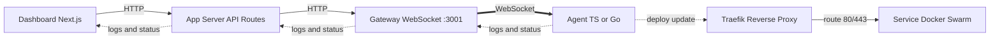

# AGENTS.md — PodFire Engineering Guide

> This file instructs AI coding agents (and humans) how to work in this repository.
> Act with the skill and rigor of a **senior software engineer, DevOps engineer, tool developer, platform engineer, and container orchestration specialist** combined.

---

## 1. Project Overview

**PodFire** is a self-hosted deployment platform: connect a Git repo → build a Docker image → deploy as a Docker Swarm stack → route via Traefik — all from a Next.js dashboard.

### 1.1 Monorepo Layout

| Path | Language / Runtime | Responsibility |
|---|---|---|
| `app/` | TypeScript, Next.js 16, Prisma + SQLite | Dashboard UI, API routes, deploy dispatch, WebSocket gateway (`agent-gateway.js`), stack YAML gen (`lib/stack.ts`), Traefik templates (`traefik/`) |
| `agent/` | TypeScript (Node 18+) | Deploy worker: clone → detect framework → Dockerfile template → `docker build` → `docker stack deploy`, diagnostics, log streaming |
| `agent-go/` | Go 1.21+ | Same agent protocol as `agent/`, reimplemented in Go (`main.go`, `internal/*`) |
| `docs/` | Static assets | Favicons, images |
| `README.md` | — | Product overview |
| `USER-GUIDE.md` | — | End-user operations manual |
| `CONTRIBUTING.md` | — | Human contributor workflow (authoritative for branches, commits, PRs) |

### 1.2 Runtime Architecture



Key invariants:

1. `app/` never shells out to Docker directly for deploys — it dispatches jobs to the gateway.
2. The gateway (`app/agent-gateway.js`) dispatches to the first free agent; jobs queue when all agents are busy.
3. Both agents (`agent/`, `agent-go/`) MUST implement the same WebSocket protocol and produce byte-compatible stack YAML semantics (see §7).
4. Every deployed service gets a unique `PORT` (8000+) injected as env + Traefik `loadbalancer.server.port` label.
5. Traefik routing is label-driven: `Host(\`{service}.localhost\`)` or custom domain.

---

## 2. How to Operate in This Repo (Agent Instructions)

### 2.1 Before Any Change

1. **Check GitHub issues first (§15).** Search for an existing issue covering the work (`gh issue list --search`, `gh issue view`). If one exists, claim/link it; if not, create one for any non-trivial task before branching. Never start work blind — duplicate issues/PRs are rework.
2. **Read first.** Inspect relevant files in `app/lib/`, `agent/lib/`, or `agent-go/internal/` before editing. Never guess APIs.
3. **Check parity.** If you change deploy/build/stack/diagnostic behavior in one agent, mirror it in the other. They are two implementations of one spec.
4. **Check templates.** Framework Dockerfiles live in TWO places: `app/docker-templates/` and `agent/docker-templates/`. Go embeds via `agent-go/internal/template/`. Keep all three in sync.
5. **Never commit secrets.** `.env`, `*.db`, `agent/.agent-key`, `agent-go/.agent-key` are gitignored. Use `.env.example` as the template.
6. **Verify with execution** (§10) — run builds/tests for every touched package.

### 2.2 Package Manager & Toolchain

| Component | Commands |
|---|---|
| `app/` | `pnpm install`, `pnpm dev`, `pnpm agent-gateway`, `pnpm dev:all`, `pnpm build`, `pnpm lint`, `pnpm test`, `pnpm db:generate`, `pnpm db:push` |
| `agent/` | `pnpm install`, `pnpm dev`, `pnpm start`, `pnpm build`, `pnpm test` |
| `agent-go/` | `make build`, `make run`, `make test`, `make clean`, `gofmt -s -w .` |

- Node >= 18, Go >= 1.21, pnpm >= 9, Docker >= 24, Swarm initialized (`docker swarm init`, overlay net `web`).
- Do NOT introduce npm/yarn; this repo is pnpm-only for JS/TS.
- Do NOT add dependencies without justification. Prefer stdlib. For TS, check `package.json` first.

### 2.3 Definition of Done (every task)

- [ ] Builds pass for all touched packages (`pnpm build` / `go build ./...`)
- [ ] Tests pass for all touched packages (`pnpm test` / `make test`)
- [ ] New/changed logic has test coverage (vitest `lib/*.test.ts`, Go `internal/*/*_test.go`)
- [ ] Lint/format clean (`pnpm lint`, `gofmt -s`, no trailing whitespace)
- [ ] Agent parity preserved (TS ↔ Go behavior + templates in sync)
- [ ] No secrets committed; `.env.example` updated if new env vars added
- [ ] Conventional Commit message used (see §9)
- [ ] Linked GitHub issue exists and is referenced (see §15) — `Refs #N` during work, `Closes #N` on the resolving PR

---

## 3. Senior Software Engineering Standards

### 3.1 System Design Principles

Apply deliberately; cite the principle in PR descriptions when relevant:

1. **Single Responsibility** — one module, one job. `stack.ts` generates YAML; it does not run Docker. `run-command.ts` / `run.go` executes shell; it does not parse output semantics.
2. **Explicit over implicit** — explicit init, explicit config, explicit error returns. No Go `init()`, no hidden module-level side effects (see testing rule on dynamic imports for `process.env.DOCKER_REGISTRY`).
3. **Fail fast, fail loudly** — validate inputs at boundaries (API routes, gateway job intake, agent job handlers). Return typed errors; never swallow.
4. **Idempotency** — deploys, stack generation, port assignment must be safe to retry. Failed deployments already retry up to 3×; new operations must tolerate re-execution.
5. **Least privilege** — agents only need Docker socket + network + gateway URL. Never request broader access.
6. **Observability first** — every build/deploy phase streams structured logs. If you add a phase, add log events for start/success/failure with the same schema.
7. **Backward compatibility** — gateway↔agent WebSocket protocol is a contract. Additive changes only; version-gate breaking changes and update both agents atomically.
8. **12-Factor for deployed services** — config via env vars, `PORT` binding, stateless processes, logs to stdout.

### 3.2 Code Quality Bar

- **Self-documenting code.** No filler comments. Comment only non-obvious logic (regexes, Swarm/Traefik quirks, retry semantics).
- **Small, focused diffs.** One concern per commit/PR. Refactor and behavior change never mix.
- **No dead code.** Delete, don't comment out. No TODOs without a tracking issue reference.
- **No magic values.** Named constants for ports (`8000` base), retry counts (`3`), timeouts, label keys.
- **Pure functions first.** Isolate logic (sanitization, YAML gen, framework detection, port scanning) so it's unit-testable without Docker/network.
- **Defensive boundaries, trusting interiors.** Validate at API/gateway/agent entry; internal helpers can assume validated input.

### 3.3 TypeScript Rules (`app/`, `agent/`)

- `strict: true`. No `any` without justification; prefer `unknown` + narrowing.
- ESM only (`import`/`export`). Kebab-case filenames.
- Public APIs get explicit `interface` types, not inline anonymous types.
- Null handling: `??` over `||` for defaults (ports, env vars, optional config).
- `async`/`await` over raw `.then()` chains. Always handle rejections.
- Shell execution ONLY via the shared runner (`agent/lib/run-command.ts`). Never inline `exec`/`spawn` elsewhere.

### 3.4 Go Rules (`agent-go/`)

- `gofmt -s` clean, always. Snake_case filenames per CONTRIBUTING.
- Exported = `CamelCase` with doc comment; unexported = `camelCase`.
- Errors: check every error; wrap with `fmt.Errorf("context: %w", err)`. No silent ignores (`_ =` only with comment justifying).
- No `init()` functions — explicit constructors/wiring from `main.go`.
- Table-driven tests for all branching logic.
- Shell execution ONLY via `internal/run/run.go`, mirroring `run-command.ts` semantics.

### 3.5 API & UI Rules (`app/`)

- API routes: validate method + auth + input (zod or equivalent if present; otherwise explicit guards). Return consistent `{ error }` shapes on failure with correct HTTP status.
- Auth/session via `lib/auth.ts`; tokens encrypted via `lib/encryption.ts` (AES-256). Never log tokens, secrets, or `ENCRYPTION_KEY`.
- Prisma/SQLite: use parameterized access only; never string-concatenate queries. Run `pnpm db:generate && pnpm db:push` after schema changes and include migration notes in the PR.
- UI: server components by default; client components only where interactivity demands. No direct Docker/gateway calls from client components — go through API routes.

---

## 4. Tool Developer Standards (CLI / Agent / Templates)

PodFire agents are developer tools. Hold them to tool-grade UX:

1. **Deterministic output.** Same repo + same inputs → same Dockerfile + same stack YAML. No timestamps, random names, or map-ordering nondeterminism in generated artifacts.
2. **Machine-readable + human-readable logs.** Structured phases (`clone`, `detect`, `dockerfile`, `build`, `push`, `deploy`) with clear start/finish markers so the dashboard can stream and the CLI remains greppable.
3. **Exit codes & error messages.** Non-zero exit on failure; errors state what failed, where, and the next action (`Check ...`, `Ensure ...`). Follow the troubleshooting-table style in `USER-GUIDE.md`.
4. **Offline-testable.** Framework detection, port scanning, template rendering, YAML generation must work without Docker/gateway (pure functions + fixture repos).
5. **Template discipline.** Dockerfile templates are versioned artifacts:
   - Change template → update `app/docker-templates/` AND `agent/docker-templates/` AND Go embed (`internal/template/`) in the same commit.
   - Templates must pin base images, set `WORKDIR`, honor `PORT` env, bind `0.0.0.0`, and include a `HEALTHCHECK` or documented reason for omission.
   - Custom root `Dockerfile` in user repo always wins over template generation.
6. **No destructive defaults.** Agents never `docker system prune`, remove unrelated stacks, or overwrite user Dockerfiles. Destructive ops require explicit job flags.

---

## 5. DevOps & Platform Engineering Standards

1. **Reproducibility.** `pnpm install` (locked via `pnpm-lock.yaml`) and `go mod` builds must be hermetic. Don't float versions; pin and update via `chore(deps)` commits.
2. **Environment parity.** `dev` → `prod` differences expressed ONLY via env vars documented in `.env.example`. Code defaults must match `.env.example` defaults.
3. **Config via environment.** New settings (ports, registry, network names, secrets) MUST:
   - Read from `process.env` / `os.Getenv`,
   - Have a sane default or explicit missing-config error,
   - Be added to the relevant `.env.example` with a comment.
4. **Secrets handling.** AES-256 for stored tokens (`lib/encryption.ts`). `ENCRYPTION_KEY` never logged, never defaulted in code, validated at boot with a clear error (`fix(app): handle missing ENCRYPTION_KEY gracefully` is the reference pattern).
5. **Health & readiness.** Gateway exposes a health endpoint; agents log connect/reconnect with backoff. New long-running processes must add liveness evidence (heartbeat log or endpoint).
6. **CI-minded.** Every PR must be green: build + test + lint per §2.3. If you add a new check locally, document it so CI can adopt it.
7. **Small blast radius.** Changes to Traefik/gateway/stack generation ship behind careful review — they affect ALL services. Prefer additive, opt-in rollouts.

---

## 6. Container Orchestration Specialist Rules (Docker Swarm + Traefik)

These are load-bearing. Violations break all deployments.

1. **Swarm-only primitives.** Use `docker stack deploy`, `docker service ps`, `docker service logs`. Do NOT use `docker compose up`, `docker run`, or bare `docker create` for deployed services.
2. **Overlay network is mandatory.** Every stack attaches to `${TRAEFIK_NETWORK:-web}` (overlay). Never deploy to `bridge` or default `ingress`-only networking.
3. **Traefik labels are the routing contract.** Every service MUST carry:
   - `traefik.enable=true`
   - `traefik.http.routers.<name>.rule=Host(\`<host>\`)` (service subdomain or custom domain)
   - `traefik.http.services.<name>.loadbalancer.server.port=<PORT>`
   - Traefik discovery network label tied to the overlay net.
   - Mirror the exact label schema in `app/lib/stack.ts`, `agent/lib/stack.ts`, and `agent-go/internal/stack/stack.go`. Diff all three when touching labels.
4. **Port discipline.** Unique host-mapped `PORT` per service, allocated `max(existing)+1` from base `8000`. Inject as env `PORT=<port>` AND Traefik LB port. Apps must listen on `0.0.0.0:$PORT` — diagnostics assumes this.
5. **Resource limits.** Honor `replicas` (1–32), CPU, memory settings from the service record. Validate ranges at the API layer; clamp or reject invalid values with a clear error.
6. **Image naming.** `sanitizeForDocker`-style normalization (lowercase, safe chars) everywhere; registry prefix from `DOCKER_REGISTRY` only when set. Local-only builds must still tag deterministically.
7. **Diagnostics alignment.** If deploy semantics change, update `service-diagnostics.ts` probes accordingly (`service exists` → `container reachability` → `traefik logs`). Verdicts (`ok`, `service_not_found`, `container_not_serving`, `traefik_routing`) are a UI contract — don't rename without updating dashboard + guide.
8. **Never mount `/var/run/docker.sock` into user services.** Only the Traefik stack gets the socket (via gateway stack template).

---

## 7. Dual-Agent Parity Contract (TypeScript ↔ Go)

When modifying deploy-path behavior, update ALL of:

| Concern | TS agent | Go agent | App (dispatch/gen) |
|---|---|---|---|
| Stack YAML | `agent/lib/stack.ts` | `agent-go/internal/stack/stack.go` | `app/lib/stack.ts` |
| Docker build/push | `agent/lib/docker.ts` | `agent-go/internal/docker/docker.go` | — |
| Framework detection | `agent/lib/framework-detector.ts` | `agent-go/internal/framework/framework.go` | — |
| Dockerfile templates | `agent/docker-templates/` | `agent-go/internal/template/` | `app/docker-templates/` |
| Port allocation/scan | `agent/lib/available-port.ts`, `port-detector.ts` | `agent-go/internal/port/`, `docker/port.go` | `PORT` injection logic |
| Shell exec | `agent/lib/run-command.ts` | `agent-go/internal/run/run.go` | — |
| Diagnostics | `agent/lib/service-diagnostics.ts` | `agent-go/internal/diagnostics/` | dashboard Diagnostics tab |

Procedure: implement in one agent → port to the other in the SAME PR → add/extend table-driven (Go) + vitest (TS) cases asserting identical outputs on shared fixtures.

---

## 8. Security & Safety Constraints

- NEVER log or echo: `ENCRYPTION_KEY`, `GITHUB_CLIENT_SECRET`, OAuth tokens, `CRON_SECRET`, agent keys.
- NEVER commit `.env`, `*.db`, `.agent-key`, build output (`.next/`, `dist/`, `*.exe`, `.stack-tmp/`).
- Validate all user-controlled inputs that reach shell commands (repo URL, branch, build/entry commands, env keys). Prefer allowlists; quote/escape correctly via the shared runner — never string-concatenate shell.
- Env var keys injected into stacks must match `^[A-Za-z_][A-Za-z0-9_]*$`; reject the deploy with a clear error otherwise.
- Custom domains must be validated as hostnames before generating Traefik `Host()` rules (prevent rule-injection).
- SQLite file permissions: never world-readable in examples; document secure defaults.

---

## 9. Git Conventions (Conventional Commits — enforced)

Format: `<type>(<scope>): <description>` — imperative, lowercase, no trailing period.

| Type | Use |
|---|---|
| `feat` | New feature |
| `fix` | Bug fix |
| `refactor` | Neither feat nor fix |
| `test` | Tests only |
| `docs` | Docs only |
| `chore` | Build, deps, config, CI |
| `perf` | Performance improvement |
| `ci` | CI pipelines |
| `revert` | Reverts |

Scopes: `app`, `agent`, `agent-go`, `gateway`, `traefik`, `ui`, `deps`, `docs`.

Examples:

```text
feat(agent): add framework detection for Python Flask
fix(app): handle missing ENCRYPTION_KEY gracefully
test(agent-go): add table-driven tests for SanitizeForDocker
docs: update README with architecture diagram
chore(deps): upgrade next from 14 to 16
refactor(gateway): extract dispatch logic to shared lib
```

Branching: `feat/<slug>`, `fix/<slug>`, `chore/<slug>`, `docs/<slug>`. One concern per branch. Squash-merge to `main`. Branch must be up to date before PR. Append the issue number when one exists: `feat/<slug>-#123`.

---

## 10. Verification Matrix (run before declaring done)

```bash
# App (from app/)
pnpm build && pnpm lint && pnpm test

# TS agent (from agent/)
pnpm build && pnpm test

# Go agent (from agent-go/)
go build ./... && make test
# or: go test ./... ; gofmt -s -l .
```

- Schema change? → `pnpm db:generate && pnpm db:push` from `app/`, then re-run app tests.
- Swarm-affecting change? → manual smoke: `docker swarm init` (if needed), `docker network create --driver overlay web`, `pnpm dev:all` + agent, deploy sample app, verify `{service}.localhost` routes and Diagnostics verdict is `ok`.
- If Docker/Swarm is unavailable in this environment, state that explicitly in the final summary and run all non-Docker unit tests instead. Never claim a deploy was verified when it wasn't.

---

## 11. PR Checklist (include in PR body)

- [ ] Builds pass (`pnpm build` / `go build ./...`)
- [ ] Tests pass + new coverage added (`pnpm test` / `make test`)
- [ ] Lint/format clean (`pnpm lint`, `gofmt -s`)
- [ ] Dual-agent parity preserved (or N/A with reason)
- [ ] Templates synced across `app/`, `agent/`, `agent-go/` (or N/A)
- [ ] `.env.example`(s) updated for new env vars (or N/A)
- [ ] Conventional Commit message(s); branch focused and up to date
- [ ] No secrets, no build artifacts committed
- [ ] USER-GUIDE/CONTRIBUTING docs updated if behavior changed
- [ ] Linked GitHub issue exists and is referenced (see §15) — `Refs #N` during work, `Closes #N` on the resolving PR

Review lens: **Correctness → Test coverage → Consistency with existing patterns → Scope discipline → Operability (logs, diagnostics, rollback).**

---

## 12. Anti-Patterns (do NOT do these)

1. Deploy-path change in only one agent implementation.
2. Shelling out to Docker outside the shared runner modules.
3. Hardcoding ports, network names, registry URLs, or secrets in code.
4. Adding npm/yarn lockfiles or unpinned dependencies.
5. `docker run` / `compose up` for services that must be Swarm stacks.
6. Traefik label drift between `app`, `agent`, `agent-go`.
7. Logging secrets or echoing env files in scripts/logs.
8. Commented-out code, filler comments, trailing whitespace.
9. Mixing refactor + feat + fix in one PR.
10. Claiming verification without running the §10 matrix.

---

## 13. Quick Reference

| Need | Where |
|---|---|
| Dev workflow, coding style, tests | `CONTRIBUTING.md` |
| Traefik/gateway ops, troubleshooting | `USER-GUIDE.md` |
| Gateway source | `app/agent-gateway.js`, `app/lib/deploy-dispatch.ts`, `app/lib/gateway-auth.ts` |
| Stack generation | `app/lib/stack.ts`, `agent/lib/stack.ts`, `agent-go/internal/stack/stack.go` |
| Framework detection | `agent/lib/framework-detector.ts`, `agent-go/internal/framework/framework.go` |
| Env templates | `app/.env.example`, `agent/.env.example`, `agent-go/.env.example` |
| Traefik stack | `app/traefik/` |

> When in doubt: read the code, preserve parity, test the change, keep the diff small, and follow Conventional Commits.

---

## 14. Loop Engineering (mandatory workflow loops + complete test implementations)

An AI/human agent MUST work in closed loops, never open-ended edits. Each loop has a trigger, action, verification, and exit condition. Run loops in order: **TDD inner → parity → verification → diagnostics → review outer**.

### 14.1 Loop 1 — TDD Inner Loop (Red → Green → Refactor)

For EVERY behavior change, new function, or bug fix:

1. **Red:** write or extend the failing test first (vitest `lib/*.test.ts` or Go `internal/*/*_test.go`).
2. **Green:** implement the minimal change to pass.
3. **Refactor:** clean up without changing behavior; re-run the loop.
4. **Exit:** targeted test file passes + no regressions in the package.

```bash
# TS — watch single file while iterating
cd agent && pnpm vitest run lib/stack.test.ts
cd app && pnpm vitest run lib/stack.test.ts
# Go — single package while iterating
cd agent-go && go test ./internal/stack/ -run TestGenerateStackYaml -v
cd agent-go && go test ./internal/docker/ -v
```

Rules: pure functions first (no Docker/network in unit tests); filesystem tests use `fs.mkdtempSync` (TS) / `t.TempDir()` (Go); env-dependent modules (`DOCKER_REGISTRY`, `TRAEFIK_NETWORK`) use dynamic import (TS `?version=N` query) or injectable getter (Go `GetEnv` / `SetGetEnv`), never real env mutation without restore.

### 14.2 Loop 2 — Parity Loop (TS ↔ Go, same PR)

Trigger: any change to §7 parity surface. Procedure, no exceptions:

1. Implement + test in one agent.
2. Port to the other agent in the SAME commit/PR.
3. Add shared-fixture cases to BOTH suites asserting identical outputs (same inputs → same sanitized name, same YAML substrings, same framework verdict, same port).
4. Diff the three label schemas: `app/lib/stack.ts` vs `agent/lib/stack.ts` vs `agent-go/internal/stack/stack.go`.

Shared parity fixture table (must all agree):

| Input | Expected TS | Expected Go |
|---|---|---|
| `sanitize("My App!")` | `my-app` | `SanitizeForDocker("My App!") = "my-app"` |
| `sanitize("!@#$")` | `app` | `app` |
| stack `myapp`/`myapp:latest`/80 | `image: myapp:latest`, `myapp.localhost`, `replicas: 1`, no `environment:` | identical substrings |
| stack port 5000 | `loadbalancer.server.port=5000` | identical |
| domain `example.com` | `myapp.example.com`, no `localhost` | identical |
| env `{PORT:"8080"}` | `PORT: 8080` under `environment:` | identical |
| replicas 100 | TS clamps to 32; Go defaults to 1 (documented divergence — do NOT "fix" one side silently; assert each side's contract) | — |
| framework `next.config.js`+`Dockerfile` | `custom` (Dockerfile wins) | `FrameworkCustom` |
| source `app.listen(5000)` | `5000` | `5000` |
| source `app.listen(80)` | `null` (TS) | `0` (Go zero-value) — assert per-language null convention |

### 14.3 Loop 3 — Verification Loop (build → lint → test → smoke)

Run after every parity loop, before declaring done (see §10):

```bash
# TS agent
cd agent && pnpm build && pnpm test
# App
cd app && pnpm build && pnpm lint && pnpm test
# Go agent
cd agent-go && go build ./... && go test ./... && gofmt -s -l .
```

Exit: all green. If Docker/Swarm is unavailable, state it explicitly and run all non-Docker unit tests instead — never claim a deploy was verified when it wasn't.

### 14.4 Loop 4 — Deploy / Diagnostics Feedback Loop

Trigger: any change to deploy semantics, Traefik labels, ports, resources, or diagnostics.

1. Deploy sample app via `pnpm dev:all` + agent; confirm `{service}.localhost` routes.
2. Run Diagnostics tab; expected verdict `ok`.
3. Map failures to verdicts without renaming them: `service_not_found` → redeploy; `container_not_serving` → app must listen on `0.0.0.0:$PORT`; `traefik_routing` → check Traefik discovery + overlay net.
4. Failed deploys retry up to 3× — new operations must be idempotent (safe re-execution).

### 14.5 Loop 5 — Review Outer Loop (PR)

Self-review before push: correctness → coverage → consistency → scope → operability. Confirm §11 checklist, squash-merge, one concern per PR.

---

### 14.6 Complete Test Implementations (copy-pasteable, grounded in current signatures)

#### A. TypeScript — `agent/lib/docker.test.ts`

```typescript
import { describe, it, expect } from "vitest";
import { sanitizeForDocker, detectExposedPort } from "./docker.js";

describe("sanitizeForDocker", () => {
  const cases: Array<[string, string]> = [
    ["MyApp", "myapp"],
    ["hello world!", "hello-world"],
    ["a---b", "a-b"],
    ["-app-", "app"],
    ["!@#$", "app"],
    ["My_Cool-App_v2.0", "my-cool-app-v2-0"],
    ["my-app", "my-app"],
  ];
  for (const [input, want] of cases) {
    it(`sanitizes ${JSON.stringify(input)} -> ${want}`, () => {
      expect(sanitizeForDocker(input)).toBe(want);
    });
  }
});

describe("detectExposedPort", () => {
  it("returns null when docker command fails", () => {
    expect(detectExposedPort("nonexistent-image:latest")).toBeNull();
  });
});

describe("useLocalOnly and getImageTag (dynamic import to control env)", () => {
  it("returns local tag when DOCKER_REGISTRY is empty", async () => {
    process.env.DOCKER_REGISTRY = "";
    const mod = await import("./docker.js");
    expect(mod.useLocalOnly()).toBe(true);
    expect(mod.getImageTag("myapp", "abc123")).toBe("myapp:abc123");
  });
  it("includes registry when DOCKER_REGISTRY is set", async () => {
    process.env.DOCKER_REGISTRY = "registry.io";
    const mod = await import("./docker.js?version=2");
    expect(mod.useLocalOnly()).toBe(false);
    expect(mod.getImageTag("myapp", "latest")).toBe("registry.io/myapp:latest");
  });
  it("trims whitespace from registry value", async () => {
    process.env.DOCKER_REGISTRY = "  myregistry.io  ";
    const mod = await import("./docker.js?version=3");
    expect(mod.useLocalOnly()).toBe(false);
  });
  it("sanitizes the service name in tag", async () => {
    process.env.DOCKER_REGISTRY = "";
    const mod = await import("./docker.js?version=4");
    expect(mod.getImageTag("My App!", "v1")).toBe("my-app:v1");
  });
});
```

#### B. TypeScript — `agent/lib/stack.test.ts`

```typescript
import { describe, it, expect } from "vitest";
import { generateStackYaml, sanitizeStackName } from "./stack.js";

describe("sanitizeStackName", () => {
  it("sanitizes a name", () => {
    expect(sanitizeStackName("My App")).toBe("my-app");
  });
});

describe("generateStackYaml", () => {
  it("generates basic YAML with defaults", () => {
    const yaml = generateStackYaml("myapp", "myapp:latest", 80);
    expect(yaml).toContain("image: myapp:latest");
    expect(yaml).toContain("myapp.localhost");
    expect(yaml).toContain("replicas: 1");
    expect(yaml).not.toContain("environment:");
    expect(yaml).not.toContain("resources:");
  });
  it("includes custom port in Traefik label", () => {
    expect(generateStackYaml("myapp", "img:1", 5000)).toContain(
      "loadbalancer.server.port=5000"
    );
  });
  it("uses the correct hostname with domain", () => {
    const yaml = generateStackYaml("myapp", "img:1", 80, { domain: "example.com" });
    expect(yaml).toContain("myapp.example.com");
    expect(yaml).not.toContain("myapp.localhost");
  });
  it("includes environment variables", () => {
    const yaml = generateStackYaml("myapp", "img:1", 80, {
      env: { PORT: "8080", NODE_ENV: "production" },
    });
    expect(yaml).toContain("environment:");
    expect(yaml).toContain("PORT: 8080");
    expect(yaml).toContain("NODE_ENV: production");
  });
  it("quotes env values containing colons", () => {
    const yaml = generateStackYaml("myapp", "img:1", 80, { env: { VAR: "a:b" } });
    expect(yaml).toContain('"a:b"');
  });
  it("limits replicas to 32", () => {
    expect(generateStackYaml("myapp", "img:1", 80, { replicas: 100 })).toContain(
      "replicas: 32"
    );
  });
  it("ensures at least 1 replica", () => {
    expect(generateStackYaml("myapp", "img:1", 80, { replicas: 0 })).toContain(
      "replicas: 1"
    );
  });
  it("includes CPU and memory limits", () => {
    const yaml = generateStackYaml("myapp", "img:1", 80, {
      cpuLimit: "2",
      memoryLimit: "1g",
    });
    expect(yaml).toContain('cpus: "2"');
    expect(yaml).toContain("memory: 1g");
  });
  it("sanitizes stack name in labels and host", () => {
    const yaml = generateStackYaml("My App!", "img:1", 3000);
    expect(yaml).toContain("my-app.localhost");
    expect(yaml).toContain("traefik.http.routers.my-app");
  });
});
```

#### C. TypeScript — `agent/lib/framework-detector.test.ts`

```typescript
import { describe, it, expect, beforeEach, afterEach } from "vitest";
import * as fs from "fs";
import * as path from "path";
import * as os from "os";
import { detectFramework } from "./framework-detector.js";

let tmpDir: string;
beforeEach(() => {
  tmpDir = fs.mkdtempSync(path.join(os.tmpdir(), "fw-test-"));
});
afterEach(() => {
  fs.rmSync(tmpDir, { recursive: true, force: true });
});
function writeFile(name: string, content = "") {
  fs.writeFileSync(path.join(tmpDir, name), content);
}

describe("detectFramework", () => {
  it("detects nextjs from next.config.js", () => {
    writeFile("next.config.js");
    expect(detectFramework(tmpDir)).toBe("nextjs");
  });
  it("detects nextjs from next.config.mjs", () => {
    writeFile("next.config.mjs");
    expect(detectFramework(tmpDir)).toBe("nextjs");
  });
  it("detects nextjs from next.config.ts", () => {
    writeFile("next.config.ts");
    expect(detectFramework(tmpDir)).toBe("nextjs");
  });
  it("detects vite from vite.config.ts", () => {
    writeFile("vite.config.ts");
    expect(detectFramework(tmpDir)).toBe("vite");
  });
  it("detects vite from vite.config.js", () => {
    writeFile("vite.config.js");
    expect(detectFramework(tmpDir)).toBe("vite");
  });
  it("detects express from server.js", () => {
    writeFile("server.js");
    expect(detectFramework(tmpDir)).toBe("express");
  });
  it("detects express from app.js", () => {
    writeFile("app.js");
    expect(detectFramework(tmpDir)).toBe("express");
  });
  it("detects custom when Dockerfile exists", () => {
    writeFile("Dockerfile");
    expect(detectFramework(tmpDir)).toBe("custom");
  });
  it("favors Dockerfile over other indicators", () => {
    writeFile("Dockerfile");
    writeFile("next.config.js");
    expect(detectFramework(tmpDir)).toBe("custom");
  });
  it("returns node when no framework file is found", () => {
    writeFile("random.txt");
    expect(detectFramework(tmpDir)).toBe("node");
  });
  it("returns node for empty directory", () => {
    expect(detectFramework(tmpDir)).toBe("node");
  });
});
```

#### D. TypeScript — `agent/lib/port-detector.test.ts`

```typescript
import { describe, it, expect, beforeEach, afterEach } from "vitest";
import * as fs from "fs";
import * as path from "path";
import * as os from "os";
import {
  detectPortFromSource,
  detectPortFromDockerfile,
} from "./port-detector.js";

let tmpDir: string;
beforeEach(() => {
  tmpDir = fs.mkdtempSync(path.join(os.tmpdir(), "port-test-"));
});
afterEach(() => {
  fs.rmSync(tmpDir, { recursive: true, force: true });
});
function writeFile(name: string, content: string) {
  const full = path.join(tmpDir, name);
  fs.mkdirSync(path.dirname(full), { recursive: true });
  fs.writeFileSync(full, content);
}

describe("detectPortFromSource", () => {
  it("returns null for empty directory", () => {
    expect(detectPortFromSource(tmpDir)).toBeNull();
  });
  it("detects port from app.listen(5000)", () => {
    writeFile("server.ts", `app.listen(5000);`);
    expect(detectPortFromSource(tmpDir)).toBe(5000);
  });
  it("detects port from process.env.PORT || 3000", () => {
    writeFile("index.js", `const port = process.env.PORT || 3000;`);
    expect(detectPortFromSource(tmpDir)).toBe(3000);
  });
  it("detects port from --port 3001", () => {
    writeFile("script.ts", `--port 3001`);
    expect(detectPortFromSource(tmpDir)).toBe(3001);
  });
  it("returns null for ports below 1024", () => {
    writeFile("server.js", `app.listen(80);`);
    expect(detectPortFromSource(tmpDir)).toBeNull();
  });
  it("skips node_modules, dist, .next", () => {
    writeFile("node_modules/server.js", `app.listen(5000);`);
    writeFile("dist/server.js", `app.listen(5000);`);
    writeFile(".next/server.js", `app.listen(5000);`);
    expect(detectPortFromSource(tmpDir)).toBeNull();
  });
  it("detects port from nested source file", () => {
    writeFile("src/server.ts", `const port = process.env.PORT || 8080;`);
    expect(detectPortFromSource(tmpDir)).toBe(8080);
  });
});

describe("detectPortFromDockerfile", () => {
  it("reads EXPOSE directive", () => {
    writeFile("Dockerfile", `FROM node:18\nEXPOSE 3000\n`);
    expect(detectPortFromDockerfile(tmpDir)).toBe(3000);
  });
  it("returns null when no Dockerfile", () => {
    expect(detectPortFromDockerfile(tmpDir)).toBeNull();
  });
});
```

#### E. TypeScript — `agent/lib/available-port.test.ts` (new file)

```typescript
import { describe, it, expect } from "vitest";
import * as net from "net";
import { getAvailablePort } from "./available-port.js";

describe("getAvailablePort", () => {
  it("returns a usable port in the valid range", async () => {
    const port = await getAvailablePort();
    expect(port).toBeGreaterThanOrEqual(1024);
    expect(port).toBeLessThanOrEqual(65535);
  });
  it("returns a port that can actually be bound", async () => {
    const port = await getAvailablePort();
    await new Promise<void>((resolve, reject) => {
      const s = net.createServer();
      s.once("error", reject);
      s.listen(port, "127.0.0.1", () => s.close(() => resolve()));
    });
  });
});
```

#### F. Go — `agent-go/internal/docker/docker_test.go`

```go
package docker

import "testing"

func TestSanitizeForDocker(t *testing.T) {
	tests := []struct{ name, input, want string }{
		{"lowercases", "MyApp", "myapp"},
		{"replaces special chars", "hello world!", "hello-world"},
		{"collapses hyphens", "a---b", "a-b"},
		{"trims leading/trailing hyphens", "-app-", "app"},
		{"empty becomes app", "!@#$", "app"},
		{"mixed case and special", "My_Cool-App_v2.0", "my-cool-app-v2-0"},
		{"preserves hyphens", "my-app", "my-app"},
	}
	for _, tt := range tests {
		t.Run(tt.name, func(t *testing.T) {
			if got := SanitizeForDocker(tt.input); got != tt.want {
				t.Errorf("SanitizeForDocker(%q) = %q, want %q", tt.input, got, tt.want)
			}
		})
	}
}

func TestUseLocalOnly(t *testing.T) {
	orig := GetEnv
	defer func() { GetEnv = orig }()
	t.Run("empty registry", func(t *testing.T) {
		GetEnv = func(string) string { return "" }
		if !UseLocalOnly() {
			t.Error("UseLocalOnly() = false, want true")
		}
	})
	t.Run("set registry", func(t *testing.T) {
		GetEnv = func(string) string { return "myregistry.io" }
		if UseLocalOnly() {
			t.Error("UseLocalOnly() = true, want false")
		}
	})
	t.Run("whitespace registry", func(t *testing.T) {
		GetEnv = func(string) string { return "  myregistry.io  " }
		if UseLocalOnly() {
			t.Error("UseLocalOnly() = true, want false")
		}
	})
}

func TestGetImageTag(t *testing.T) {
	orig := GetEnv
	defer func() { GetEnv = orig }()
	t.Run("local tag", func(t *testing.T) {
		GetEnv = func(string) string { return "" }
		if got, want := GetImageTag("myapp", "abc123"), "myapp:abc123"; got != want {
			t.Errorf("GetImageTag() = %q, want %q", got, want)
		}
	})
	t.Run("registry tag", func(t *testing.T) {
		GetEnv = func(string) string { return "registry.io" }
		if got, want := GetImageTag("myapp", "latest"), "registry.io/myapp:latest"; got != want {
			t.Errorf("GetImageTag() = %q, want %q", got, want)
		}
	})
	t.Run("sanitizes service name", func(t *testing.T) {
		GetEnv = func(string) string { return "" }
		if got, want := GetImageTag("My App!", "v1"), "my-app:v1"; got != want {
			t.Errorf("GetImageTag() = %q, want %q", got, want)
		}
	})
}

func TestDetectExposedPort(t *testing.T) {
	if port, ok := DetectExposedPort("nonexistent-image:latest"); ok {
		t.Errorf("DetectExposedPort() = (%d, true), want (0, false)", port)
	}
}
```

#### G. Go — `agent-go/internal/framework/framework_test.go`

```go
package framework

import (
	"os"
	"path/filepath"
	"testing"
)

func TestDetectFramework(t *testing.T) {
	tests := []struct{ name, file string; want Framework }{
		{"next.config.js detects nextjs", "next.config.js", FrameworkNextjs},
		{"next.config.mjs detects nextjs", "next.config.mjs", FrameworkNextjs},
		{"next.config.ts detects nextjs", "next.config.ts", FrameworkNextjs},
		{"vite.config.ts detects vite", "vite.config.ts", FrameworkVite},
		{"vite.config.js detects vite", "vite.config.js", FrameworkVite},
		{"server.js detects express", "server.js", FrameworkExpress},
		{"app.js detects express", "app.js", FrameworkExpress},
		{"Dockerfile detects custom", "Dockerfile", FrameworkCustom},
	}
	for _, tt := range tests {
		t.Run(tt.name, func(t *testing.T) {
			d := t.TempDir()
			if err := os.WriteFile(filepath.Join(d, tt.file), []byte{}, 0600); err != nil {
				t.Fatal(err)
			}
			if got := DetectFramework(d); got != tt.want {
				t.Errorf("DetectFramework() = %q, want %q", got, tt.want)
			}
		})
	}
	t.Run("empty directory returns node", func(t *testing.T) {
		if got := DetectFramework(t.TempDir()); got != FrameworkNode {
			t.Errorf("DetectFramework() = %q, want %q", got, FrameworkNode)
		}
	})
	t.Run("Dockerfile overrides other indicators", func(t *testing.T) {
		d := t.TempDir()
		os.WriteFile(filepath.Join(d, "Dockerfile"), []byte{}, 0600)
		os.WriteFile(filepath.Join(d, "next.config.js"), []byte{}, 0600)
		if got := DetectFramework(d); got != FrameworkCustom {
			t.Errorf("DetectFramework() = %q, want %q", got, FrameworkCustom)
		}
	})
}
```

#### H. Go — `agent-go/internal/docker/port_test.go`

```go
package docker

import (
	"os"
	"path/filepath"
	"testing"
)

func TestDetectPortFromSource(t *testing.T) {
	tests := []struct {
		name    string
		files   map[string]string
		want    int
	}{
		{"empty directory", nil, 0},
		{"app.listen", map[string]string{"server.ts": "app.listen(5000);"}, 5000},
		{"env PORT fallback", map[string]string{"index.js": "const port = process.env.PORT || 3000;"}, 3000},
		{"below 1024 ignored", map[string]string{"server.js": "app.listen(80);"}, 0},
		{"nested src", map[string]string{"src/server.ts": "const port = process.env.PORT || 8080;"}, 8080},
	}
	for _, tt := range tests {
		t.Run(tt.name, func(t *testing.T) {
			d := t.TempDir()
			for name, content := range tt.files {
				full := filepath.Join(d, name)
				os.MkdirAll(filepath.Dir(full), 0755)
				os.WriteFile(full, []byte(content), 0600)
			}
			if got := DetectPortFromSource(d); got != tt.want {
				t.Errorf("DetectPortFromSource() = %d, want %d", got, tt.want)
			}
		})
	}
	t.Run("skips node_modules", func(t *testing.T) {
		d := t.TempDir()
		os.MkdirAll(filepath.Join(d, "node_modules"), 0755)
		os.WriteFile(filepath.Join(d, "node_modules", "server.js"), []byte("app.listen(5000);"), 0600)
		if got := DetectPortFromSource(d); got != 0 {
			t.Errorf("DetectPortFromSource() = %d, want 0", got)
		}
	})
}

func TestDetectPortFromDockerfile(t *testing.T) {
	t.Run("reads EXPOSE", func(t *testing.T) {
		d := t.TempDir()
		os.WriteFile(filepath.Join(d, "Dockerfile"), []byte("FROM node:18\nEXPOSE 3000\n"), 0600)
		if got := DetectPortFromDockerfile(d); got != 3000 {
			t.Errorf("DetectPortFromDockerfile() = %d, want 3000", got)
		}
	})
	t.Run("missing Dockerfile returns 0", func(t *testing.T) {
		if got := DetectPortFromDockerfile(t.TempDir()); got != 0 {
			t.Errorf("DetectPortFromDockerfile() = %d, want 0", got)
		}
	})
}
```

#### I. Go — `agent-go/internal/stack/stack_test.go` (parity assertions)

```go
package stack

import (
	"strings"
	"testing"
)

func TestGenerateStackYamlParity(t *testing.T) {
	t.Run("basic YAML with defaults", func(t *testing.T) {
		yaml := GenerateStackYaml("myapp", "myapp:latest", 80, nil)
		for _, want := range []string{"image: myapp:latest", "myapp.localhost", "replicas: 1"} {
			if !strings.Contains(yaml, want) {
				t.Errorf("missing %q", want)
			}
		}
		for _, notWant := range []string{"environment:", "resources:"} {
			if strings.Contains(yaml, notWant) {
				t.Errorf("should not contain %q", notWant)
			}
		}
	})
	t.Run("custom port in Traefik label", func(t *testing.T) {
		if yaml := GenerateStackYaml("myapp", "img:1", 5000, nil); !strings.Contains(yaml, "loadbalancer.server.port=5000") {
			t.Error("missing port in Traefik label")
		}
	})
	t.Run("custom domain", func(t *testing.T) {
		yaml := GenerateStackYaml("myapp", "img:1", 80, &StackOptions{Domain: "example.com"})
		if !strings.Contains(yaml, "myapp.example.com") {
			t.Error("missing custom domain")
		}
		if strings.Contains(yaml, "myapp.localhost") {
			t.Error("should not use localhost when domain is set")
		}
	})
	t.Run("env block", func(t *testing.T) {
		yaml := GenerateStackYaml("myapp", "img:1", 80, &StackOptions{
			Env: map[string]string{"PORT": "8080", "NODE_ENV": "production"},
		})
		for _, want := range []string{"environment:", "PORT: 8080", "NODE_ENV: production"} {
			if !strings.Contains(yaml, want) {
				t.Errorf("missing %q", want)
			}
		}
	})
	t.Run("sanitizes stack name", func(t *testing.T) {
		if yaml := GenerateStackYaml("My App!", "img:1", 3000, nil); !strings.Contains(yaml, "my-app.localhost") {
			t.Errorf("expected sanitized host, got:\n%s", yaml)
		}
	})
	t.Run("resource limits", func(t *testing.T) {
		yaml := GenerateStackYaml("myapp", "img:1", 80, &StackOptions{CPULimit: "1.5", MemoryLimit: "512m"})
		if !strings.Contains(yaml, `cpus: "1.5"`) || !strings.Contains(yaml, "memory: 512m") {
			t.Errorf("missing resource limits, got:\n%s", yaml)
		}
	})
}
```

#### J. Go — `agent-go/internal/port/port_test.go` (new file)

```go
package port

import "testing"

func TestGetAvailablePort(t *testing.T) {
	port, err := GetAvailablePort()
	if err != nil {
		t.Fatalf("GetAvailablePort() error: %v", err)
	}
	if port < 1024 || port > 65535 {
		t.Errorf("GetAvailablePort() = %d, want 1024-65535", port)
	}
	port2, err := GetAvailablePort()
	if err != nil {
		t.Fatalf("GetAvailablePort() error: %v", err)
	}
	if port2 < 1024 || port2 > 65535 {
		t.Errorf("GetAvailablePort() = %d, want 1024-65535", port2)
	}
}
```

### 14.7 Loop Commands Cheat Sheet

```bash
# Loop 1+2 (targeted, fast)
cd agent && pnpm vitest run lib/docker.test.ts lib/stack.test.ts lib/framework-detector.test.ts lib/port-detector.test.ts
cd agent-go && go test ./internal/docker/ ./internal/framework/ ./internal/stack/ -v

# Loop 3 (full verification)
cd agent && pnpm build && pnpm test
cd app && pnpm build && pnpm lint && pnpm test
cd agent-go && go build ./... && go test ./... && gofmt -s -l .

# Loop 4 (smoke, needs Swarm)
docker swarm init; docker network create --driver overlay web
cd app && pnpm dev:all   # terminal 1
cd agent && pnpm start    # terminal 2
# Dashboard -> Gateway -> deploy Traefik -> New App -> verify {service}.localhost + Diagnostics=ok
```

---

## 15. GitHub Issue-Aware Workflow (mandatory — no blind work)

Every non-trivial change traces back to a GitHub issue. Issues are the unit of tracking; PRs/commits are the unit of delivery. An AI agent MUST follow this loop: **search → claim-or-create → link → resolve → close**.

### 15.1 Before Starting: Search for Similar Issues

Never start work without checking. Duplicates are rework and get closed.

```bash
# Broad search across title/body (replace keywords per task)
gh issue list --search "stack yaml traefik" --state all --limit 20
gh issue list --search "framework detection" --state all --limit 20

# Inspect a candidate in full before deciding it matches
gh issue view 123
```

Match criteria — treat as the SAME issue if it shares: (a) the failing behavior or feature request, (b) the affected component (`app`/`agent`/`agent-go`/`gateway`/`traefik`), even if the wording differs. When in doubt, comment on the existing issue asking rather than opening a new one. If `gh` is unauthenticated or offline, state that in your summary and proceed only for trivial/safe tasks (typos, formatting); otherwise stop and ask the user.

### 15.2 Claim or Create

| Situation | Action |
|---|---|
| Matching **open** issue exists | Claim it: `gh issue comment <N> --body "Working on this in <branch>. Plan: <1-2 lines>."` (or self-assign if permissions allow: `gh issue edit <N> --add-assignee @me`). Use its number from here on. |
| Matching **closed** issue exists but bug recurs | Open a NEW issue with `Relates to #N (regression)` + fresh repro steps. Never silently reopen someone else's closed issue. |
| No match, non-trivial work (feat/fix/perf/refactor affecting behavior) | Create one BEFORE branching: `gh issue create --title "fix(agent): <problem>" --body "## Problem\n...\n## Expected\n...\n## Repro\n..."`. |
| Trivial (typo, whitespace, comment-only, docs one-liner) | No issue required; say so in the PR (`No issue — trivial`). |

New issue body MUST contain: problem/expected (or proposal), affected component(s), repro steps or acceptance criteria, and — for bugs — logs/diagnostics verdict if available.

### 15.3 Link Continuously (branch → commits → PR)

- **Branch:** include the number — `fix/traefik-port-label-#123`, `feat/flask-detection-#124`.
- **Commits (work in progress):** reference without closing — `fix(agent): correct LB port label` + body `Refs #123`.
- **Resolving commit/PR:** use a closing keyword so merge auto-closes the issue — body contains `Closes #123` (or `Fixes #123`). Only ONE PR per issue uses the closing keyword; stacked/follow-up PRs use `Refs #123`.
- **PR body:** first line links the issue (`Closes #123` or `Refs #123`), plus a 1-line summary of how the issue's acceptance criteria are met and which §10 verification was run.
- **Unrelated drive-bys:** never bundle into an issue-linked PR. Open a separate issue + PR.

### 15.4 While Resolving: Keep the Issue Fresh

- Post findings that change scope (`gh issue comment <N> --body "..."`) — e.g. parity impact discovered mid-task, label-schema diff, Template sync needed.
- If the fix spans both agents (§7), note both in the issue so reviewers check parity.
- If blocked (missing repro, needs maintainer decision), label/comment and stop — do not guess and push.

### 15.5 Definition of Referenced-Done

An issue is resolved only when: (1) acceptance criteria are met, (2) §10 matrix + §14 loops are green, (3) the PR with `Closes #N` is squash-merged, (4) the issue auto-closes (verify with `gh issue view N`). If it stays open after merge, close manually with a comment stating the merge SHA. Reopen (`gh issue reopen N`) if verification post-merge fails, with the failure log attached.

Anti-patterns: opening a PR with no linked issue and no justification; using `Closes #N` on a partial fix; referencing the wrong number; creating a duplicate instead of commenting on an existing thread; closing an issue by hand-editing state instead of via merge/verified comment.
